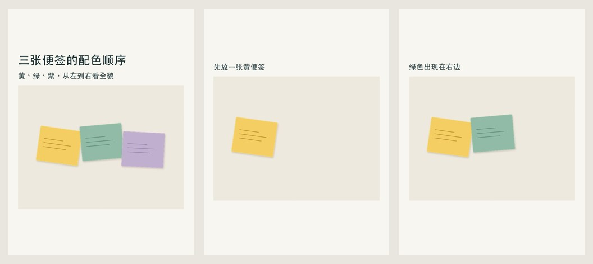

# 小红书视频转图文与网页预览

给自己的 AI 一条有权改编的小红书视频链接，让它挑选原帧、写出图文笔记，再到你扫码授权的创作者中心打开发布前预览。普通官网播放器能提供原片时，整条流程可以在没有 ChatCut、没有 TikHub 密钥的电脑上运行。

| Skill | 交给它什么 | 它交付什么 |
| --- | --- | --- |
| [视频转图文笔记 · xhs-video-to-note](skills/xhs-video-to-note/SKILL.md) | 一条视频分享链接，或本地原片 | 一个图文文件夹，含标题 `title.txt`、正文 `content.txt`、封面 `cover.jpg` 和依次编号的内页 |
| [小红书图文预览与发布 · xhs-publish-note](skills/xhs-publish-note/SKILL.md) | 上一步的文件夹，或你自己准备好的图文 | 自动上传图片、填写并核对文案，打开官网发布前的笔记预览。正式发布有单独的授权和命令 |

[](examples/cards/note)

自己打开 [5.5 秒示例原片](examples/cards/source.mp4)、[标题](examples/cards/note/title.txt) 或 [正文](examples/cards/note/content.txt)，可以看到两个 Skill 之间实际交接的内容。示例使用预设文案以便复现；处理你的视频时，由调用工具的 AI 看图和写稿。

## 第一次使用，复制给自己的 AI

在 GitHub 选 **Code → Download ZIP** 并解压，或克隆仓库。用能运行本地命令、读取图片的 AI 工具打开包含本 README 的项目目录。支持 Agent Skills 的工具也能分别加载上表两个目录。若你的客户端通过本地 MCP 接工具，按 [MCP 接入与网页预览](bridge/README.md) 配置即可。

把下面这段话和你的链接一起交给 AI，替换两处方括号里的内容。

> 请读这个项目的 README 和 skills 下的两个 SKILL.md。这条视频我有权改编：[粘贴一条小红书视频分享链接]。请先走免费的官网播放器。取得原片后，看画面再选图，给我标题、正文、封面和内页。若下载受限就告诉我原因，等我提供本地原片再接着做。我这次只授权把成稿上传到 [创作者中心显示的完整昵称] 做网页预览。首次扫码时叫我，完成后保留 Chrome 窗口；用 MCP 时把官网预览图返回给我。停在预览，不要正式发布，也不要调用付费服务。

**你需要参与的地方**是首次在小红书自己的窗口扫码，以及免费入口受限时提供一份有权使用的原片。读视频和登录投稿分开进行。只做本地图文时可以跳过小红书账号；只想预览现成稿件时直接从下面第 4 步开始。

## 从链接到官网预览

以下是 AI 实际使用的命令，也可以在仓库根目录手动运行。示例适用于 macOS 终端。把一篇作品的输入和输出都放在 `work/first/`，下一篇另用新目录。

### 1. 首次准备本机工具

准备 Node.js 22 或以上及 npm、Python 3.9 或以上、含 `ffmpeg` 和 `ffprobe` 的 FFmpeg、桌面 Google Chrome 和一款中文字体。FFmpeg 负责读视频和抽帧，Chrome 负责打开官网。已有这些工具可以直接装项目依赖。[Node.js](https://nodejs.org/en/download) · [Python](https://www.python.org/downloads/) · [FFmpeg](https://ffmpeg.org/download.html) · [Google Chrome](https://www.google.com/chrome/)

```sh
python3 -m venv .venv
.venv/bin/python -m pip install -r skills/xhs-video-to-note/requirements.txt
npm ci --prefix skills/xhs-video-to-note/browser
npm ci --prefix skills/xhs-publish-note
mkdir -p work/first
```

想先确认安装是否成功，可以用随仓库附带的原片在本地重做一份三图笔记。成功时会列出封面、两张内页和稿件指纹。这个演示无需登录账号。

```sh
.venv/bin/python examples/cards/demo.py --out work/demo-note
```

### 2. 免费取得有权使用的原片

让 AI 把你给的分享链接写入 `work/first/share.txt`，或自行创建这个纯文本文件。整个 `work/` 目录已加入 Git 忽略规则。以下命令打开独立的匿名 Chrome 窗口，通过官方作品页核对笔记和可播放的视频文件。

```sh
node skills/xhs-video-to-note/browser/download.mjs \
  --url-file work/first/share.txt --out work/first/source
```

看到 `status: ready` 后，按返回的 `video` 路径继续。使用上述目录时，原片在 `work/first/source/source.mp4`，同目录的 `source.json` 记录笔记 ID、文件指纹、时长与尺寸。

**如果显示 `needs_local_video`**，先读返回的 `reason`。缺 Chrome、ffprobe 或浏览器依赖时回到第 1 步补齐。若作品要求登录验证、限制保存，或工具无法确认唯一的完整视频，请作者提供原片，或使用你已合法保存的副本。把它放到 `work/first/original.mp4`，再把第 3 步的 `--video` 改成这个路径，后续选图、成稿和网页预览照常。另一个网络会话能否读取同一条链接取决于当时的官网状态。TikHub 是另行授权的可选付费入口，见 [取得原片](skills/xhs-video-to-note/SKILL.md#取得原片)。

### 3. 让 AI 根据原片制稿

```sh
.venv/bin/python skills/xhs-video-to-note/scripts/draft.py prepare \
  --video work/first/source/source.mp4 --work work/first/frames --audio
cp work/first/frames/plan.template.json work/first/plan.json
```

**在这里让 AI 打开原帧。** 它查看 `work/first/frames/frames/` 下的图片，给每段正文选证据，为封面和内页选画面、写图注，再填好 `work/first/plan.json`。标题最多 20 字。涉及口述内容时需核对音轨或可靠转录；取出的帧没有拍到关键动作时，可以在新的取帧目录用 `--at` 补取具体时间点。空模板需要填好才能生成成品。[选图与编辑计划说明](skills/xhs-video-to-note/SKILL.md#看原片编辑图文)

```sh
.venv/bin/python skills/xhs-video-to-note/scripts/draft.py build \
  --work work/first/frames --plan work/first/plan.json --out work/first/note
node skills/xhs-publish-note/cli.mjs check work/first/note --json
```

打开成品的封面和所有内页，核对图注、裁切、文字与图片顺序。只需要稿件时，`work/first/note/` 就是可以带走或交给另一个 AI 的文件夹。取帧与出稿命令写入新目录；要重做一版时可改用 `frames-v2/` 或 `note-v2/`。

### 4. 登录自己的账号，停在发布前

给本机账号起一个固定的名字，例如 `my-xhs`。首次使用或会话失效时，运行登录命令，在官网 Chrome 窗口里扫码。把示例中的「你的官网昵称」换成创作者中心当前显示的完整昵称。登录会话保存在本机用户目录，后续可复用。

```sh
node skills/xhs-publish-note/cli.mjs login \
  --account my-xhs --nickname '你的官网昵称' --json
node skills/xhs-publish-note/cli.mjs preview work/first/note \
  --account my-xhs --nickname '你的官网昵称' --keep-open --json
```

**成功标志**是日志出现「预览完成，已停在发布前」。官网应该显示正确的账号和图片数量，手机样式的笔记预览里可以核对封面、标题与正文。`--keep-open` 会等你关掉窗口才结束，网页预览会把素材上传到创作者中心，平台可能保存为草稿。图片上传中断时，保留原稿，查看当次日志给出的运行记录和现场截图，再从同一份稿件重开预览。需要正式提交时另见 [发布 Skill](skills/xhs-publish-note/SKILL.md)。

## 验证范围与许可证

已在 macOS 验证公开播放器取片、本地制稿及创作者中心网页预览。免费入口能否取得视频取决于当时的官网状态。正式提交、可选付费查询和其他操作系统的完整流程仍待独立实测。

项目代码采用 [MIT 许可证](LICENSE)。使用自己的素材时，请确认具备下载、改编及相应展示或发布的权利。仓库中的便签演示可用于复现流程。
